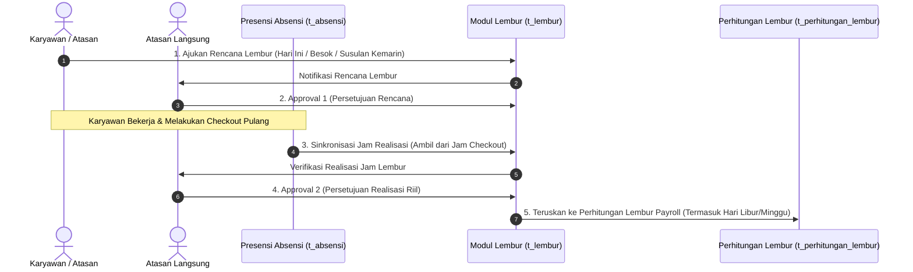
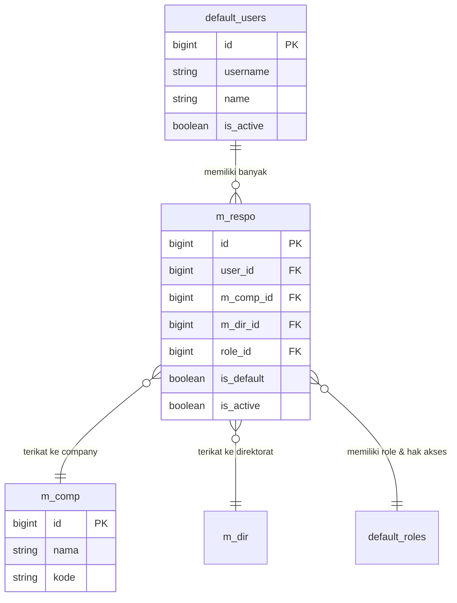

# 📝 NOTULENSI & REKAP HASIL SHOWING HRIS BBS (SESI 2)
**Tanggal Pelaksanaan Showing:** Kamis, 5 November 2026  
**Tanggal Penyusunan Notulensi:** Kamis, 5 November 2026  
**Pencatat Lapangan & Dev Lead:** Rey Cannavaro  
**Kolaborator Lapangan:** Mas Duta  
**Pihak Pengguna / Klien:** Manajemen & Tim HR PT Berkah Bersaudara Sentosa (BBS)  
**Tindak Lanjut:** Sprint Pengembangan Lanjutan (November 2026)  

---

## 📌 Ringkasan Eksekutif
Berdasarkan sesi demonstrasi sistem (*showing*) lanjutan pada tanggal **5 November 2026**, alur inti penggajian hasil perbaikan sprint sebelumnya (aturan denda keterlambatan pembulatan ke atas kelipatan 30 menit, prorata mutasi divisi Opsi 2, subsidi PPh 21 *gross-up*, sinkronisasi dua arah status karyawan aktif/inaktif dengan tanggal berhenti kerja, serta siklus cut-off tanggal 25) telah berhasil disimulasikan dan diterima dengan baik.

Pada sesi showing hari ini, pihak manajemen dan HR BBS memberikan umpan balik (*feedback*) serta penyesuaian aturan bisnis baru untuk menyempurnakan operasional riil di lapangan. Dokumen notulensi ini merangkum seluruh poin masukan baru tersebut beserta analisis teknis, modul terdampak, dan matriks rencana kerja pengembangannya.

---

## 📋 Detail Notulensi & Analisis Kebutuhan Bisnis

### 1. Modul Transaksi Lembur (`t_lembur` & `t_perhitungan_lembur`)

#### A. Skenario Alur Lembur Dua Tahap (Pengajuan vs Realisasi Absensi)
* **Kebutuhan Bisnis:**  
  Sebelumnya, lembur hanya memiliki satu kali pengajuan dan persetujuan berbasis jam rencana. Klien membutuhkan alur lembur yang membedakan antara **Rencana Lembur** dan **Realisasi Lembur Aktual** agar pembayaran upah lembur akurat sesuai kehadiran nyata di lapangan.
* **Alur Skenario Baru:**
  1. **Pengajuan Rencana Lembur:**  
     Karyawan atau atasan mengajukan Surat Perintah Lembur (SPL) untuk penugasan lembur (bisa untuk hari ini nanti malam, atau untuk besok).
  2. **Approval 1 (Persetujuan Rencana):**  
     Atasan langsung menyetujui rencana penugasan lembur tersebut.
  3. **Penarikan Realisasi dari Absensi (Checkout Presensi):**  
     Ketika karyawan menyelesaikan lembur dan melakukan absensi kepulangan (*checkout* di mesin/mobile presensi `t_absensi`), sistem secara otomatis mengambil jam *checkout* tersebut sebagai jam selesai lembur aktual.
  4. **Approval 2 (Persetujuan Realisasi):**  
     Atasan memverifikasi dan menyetujui kembali (*approval final*) realisasi jam lembur yang tercatat dari jam checkout sebelum data diteruskan ke perhitungan lembur payroll.
  5. **Fleksibilitas Pengajuan Susulan (Hari Sebelumnya / Backdated):**  
     Sistem harus mengizinkan pengajuan lembur untuk hari kemarin / hari sebelumnya (misal kasus penanganan darurat/insiden di lapangan yang tidak sempat mengajukan rencana lembur di awal).

#### B. Lembur Hari Libur Nasional & Hari Minggu
* **Kebutuhan Bisnis:**  
  Jika divisi operasional/proyek memerlukan pekerjaan lembur di hari Minggu atau tanggal merah (Hari Libur Nasional), pengajuan lembur harus **tetap bisa diproses dan dikalkulasikan** secara otomatis di modul `t_perhitungan_lembur` dan `t_perhitungan_gaji` dengan mengacu pada tarif pengali lembur hari libur di `m_lembur`.

---

### 2. Modul Perhitungan Gaji & Master Karyawan (`m_kary` & `t_perhitungan_gaji`)

#### A. Format Pemisah Ribuan (*Thousand Separator*) di Master Karyawan
* **Kebutuhan Bisnis:**  
  Input nominal pada master karyawan (khususnya field `gaji_pokok` personal, `gaji_acuan` BPJS, dan tunjangan lainnya) saat ini masih berupa angka polos (contoh: `12000000` atau `350000`). Hal ini menyulitkan HRD dalam membaca jumlah digit nol sehingga rawan terjadi *human error* salah ketik nominal.
* **Solusi Sistem:**  
  Menerapkan *format separator ribuan* interaktif (contoh: `12.000.000` atau `350.000`) pada input form dan tabel tampilan `m_kary`, dengan mekanisme sanitasi otomatis menjadi nilai numerik murni saat disimpan ke database backend.

#### B. Pembatasan Hak Akses Informasi Upah (*Salary Confidentiality*)
* **Kebutuhan Bisnis:**  
  Data gaji pokok dan rincian komponen upah bersifat sangat rahasia (*strictly confidential*). Informasi ini **hanya boleh diakses oleh Kepala HRD dan Superadmin**.
* **Solusi Sistem:**  
  Menerapkan filter otorisasi/role-based security pada modul `m_kary`, `m_standart_gaji`, dan rincian gaji di `t_perhitungan_gaji`:
  - Jika user yang login adalah **Superadmin** atau **Kepala HRD**, kolom dan rincian upah ditampilkan utuh.
  - Jika user adalah role lain (staf HR umum, admin cabang, atasan departemen non-HR), kolom nominal gaji pokok, gaji acuan, dan komponen gaji disembunyikan (*masked* atau di-hide).

---

### 3. Modul Cuti & Izin Karyawan (`t_cuti`)

#### A. Pengecualian Batas 3 Hari Berturut-turut untuk Cuti Tertentu
* **Kebutuhan Bisnis:**  
  Sebelumnya berlaku validasi ketat bahwa cuti hanya boleh diambil maksimal 3 hari berturut-turut. Namun di lapangan, ada jenis cuti resmi yang wajib diberikan lebih dari 3 hari, yaitu:
  - **Cuti Melahirkan / Bersalin:** Diberikan berturut-turut hingga masa cuti melahirkan habis (contoh: 3 bulan / 90 hari).
  - **Cuti Keagamaan / Ibadah:** Contoh ibadah Haji atau Umroh yang memerlukan durasi panjang (di atas 3 hari berturut-turut).
* **Solusi Sistem:**  
  Membuka validasi batas 3 hari berturut-turut khusus untuk kategori cuti Melahirkan dan Cuti Keagamaan.

#### B. Konfigurasi Batas Hari Dinamis dari `m_general` (`value_2`)
* **Kebutuhan Bisnis:**  
  Batas maksimal hari untuk setiap tipe izin/cuti tidak boleh di-hardcode kaku di dalam source code PHP/JS, melainkan harus fleksibel dan dapat dikonfigurasi melalui master referensi `m_general`.
* **Solusi Sistem:**  
  Mengambil batas maksimal durasi hari cuti dari kolom `value_2` pada tabel `m_general` (group cuti terkait). Jika `value_2` terisi (misal: 90 untuk melahirkan, 40 untuk haji), maka batas pengajuan mengikuti angka yang tercantum di database tersebut.

---

### 4. Modul Libur Nasional & Integrasi Cuti Tahunan (`m_libur_nasional` & `t_cuti`)

* **Kebutuhan Bisnis:**  
  Perlu dipastikan apakah modul `m_libur_nasional` sudah aktif berjalan penuh di sistem dan terintegrasi secara benar dengan jatah cuti tahunan karyawan.
* **Aturan Bisnis Integritas:**  
  - Apabila karyawan mengajukan cuti dalam rentang tanggal tertentu yang di dalamnya terdapat Hari Libur Nasional (tanggal merah resmi pemerintah yang tercatat di `m_libur_nasional`), maka hari libur nasional tersebut **TIDAK BOLEH memotong saldo kuota cuti tahunan** karyawan.
  - Kuota cuti tahunan (12 hari) hanya dipotong berdasarkan **hari kerja efektif** saja.

---

### 5. Modul Piutang & Kasbon Karyawan (`t_potongan`)

#### A. Log / Riwayat Pelunasan Kasbon (`t_potongan_det_bayar`)
* **Kebutuhan Bisnis:**  
  Saat ini transaksi pelunasan kasbon belum memiliki tampilan riwayat/log yang komprehensif di antarmuka pengguna (*frontend*), sehingga tim Finance sulit melacak kapan pembayaran dilakukan, apakah melalui potong gaji bulanan atau pelunasan tunai di luar sistem.
* **Solusi Sistem:**  
  Menambahkan tab/modal **History Pembayaran & Pelunasan** pada modul `t_potongan` yang menampilkan detail data dari `t_potongan_det_bayar` (tanggal bayar, nominal bayar, status bayar, nomor slip gaji/keterangan, dan user pencatat).

#### B. Field Tanggal Pelunasan Manual yang Fleksibel (*Adjustable Date*)
* **Kebutuhan Bisnis:**  
  Pada saat kasir/finance menekan tombol aksi **Pelunasan Manual** (untuk karyawan yang melunasi piutang secara tunai), sistem harus menyediakan form dialog input **Tanggal Pelunasan**.
* **Solusi Sistem:**  
  Form input tanggal pelunasan manual secara default terisi dengan tanggal hari ini (*current date*), namun dapat diubah/disesuaikan (*adjustable*) oleh user Finance jika pembayaran tunai riil telah diterima pada tanggal sebelumnya.

---

### 6. Arsitektur Multi-Responsibility & Multi-Company (`m_respo`)

* **Kebutuhan Bisnis:**  
  Dalam operasional grup BBS, terdapat kebutuhan fleksibilitas akses pengguna di mana **1 User akun login dapat memegang banyak responsibility (`multi-respo`) dan dapat mengelola banyak company/cabang (`multi-company`)** tanpa harus membuat banyak akun login terpisah.
* **Konsep Desain Teknis:**
  - Pembuatan tabel master/relasi `m_respo` yang menghubungkan `user_id` dengan role, hak akses, dan entitas `m_comp_id` / `m_dir_id`.
  - Penambahan fitur *Switch Company / Responsibility* pada header sistem agar user berwenang dapat berpindah konteks kerja secara instan tanpa perlu *logout*.
  - Pemfilteran query database secara otomatis menyesuaikan konteks company aktif yang sedang dipilih oleh pengguna.

---

## 📊 Matriks Rencana Kerja & Tindak Lanjut (Sprint 5 November 2026)

| No | Modul / Fitur | Kategori | PIC | File / Komponen Terdampak | Prioritas | Status |
|---|---|---|:---:|---|:---:|:---:|
| 1 | **Skenario Lembur 2 Tahap (Rencana & Realisasi Checkout)** | Lembur | Tim Dev | `t_lembur`, `t_absensi`, `Blades/t_lembur.blade.php`, `Javascript/t_lembur.js` | Tinggi | 📝 Pending |
| 2 | **Lembur Hari Minggu & Libur Nasional di Payroll** | Lembur | Tim Dev | `Cores/PerhitunganGaji.php`, `Models/t_perhitungan_lembur/Custom.php` | Tinggi | 📝 Pending |
| 3 | **Pengajuan Lembur Susulan (Hari Sebelumnya / Backdated)** | Lembur | Tim Dev | `Models/t_lembur/Custom.php`, `Javascript/t_lembur.js` | Sedang | 📝 Pending |
| 4 | **Separator Ribuan pada Nominal Upah Master Karyawan** | Master Karyawan | Tim Dev | `Blades/m_karyawan.blade.php`, `Javascript/m_karyawan.js`, `Models/m_kary/Custom.php` | Sedang | 📝 Pending |
| 5 | **Restriksi Akses Data Gaji (Kepala HRD & Superadmin Saja)** | Keamanan Payroll | Tim Dev | `Models/m_kary/Custom.php`, `Models/t_perhitungan_gaji/Custom.php`, `Blades/m_karyawan.blade.php` | Tinggi | 📝 Pending |
| 6 | **Pengecualian Batas 3 Hari (Cuti Melahirkan & Keagamaan)** | Cuti | Tim Dev | `Models/t_cuti/Custom.php`, `Javascript/t_cuti.js` | Tinggi | 📝 Pending |
| 7 | **Batas Hari Maksimal Cuti Dinamis dari `m_general` (`value_2`)** | Cuti | Tim Dev | `Models/t_cuti/Custom.php`, `Javascript/t_cuti.js` | Tinggi | 📝 Pending |
| 8 | **Verifikasi Libur Nasional Tidak Memotong Jatah Cuti Tahunan** | Libur & Cuti | Tim Dev | `Models/t_cuti/Custom.php`, `Models/m_libur_nasional/Custom.php` | Tinggi | 📝 Pending |
| 9 | **Modal / Tampilan Riwayat (Log) Pelunasan Kasbon** | Piutang / Kasbon | Tim Dev | `Blades/t_potongan.blade.php`, `Javascript/t_potongan.js`, `Models/t_potongan/Custom.php` | Sedang | 📝 Pending |
| 10 | **Field Tanggal Adjustable pada Pelunasan Manual Kasbon** | Piutang / Kasbon | Tim Dev | `Blades/t_potongan.blade.php`, `Javascript/t_potongan.js`, `Models/t_potongan/Custom.php` | Sedang | 📝 Pending |
| 11 | **Perancangan Konsep & Skema Multi-Respo Multi-Company (`m_respo`)** | Arsitektur Akses | Tim Dev | `Models/m_respo/*`, Migrasi & Middleware Otorisasi | Tinggi | 📝 Pending |

---

## 🎯 Detail Action Items per Track Pengerjaan

### Track 1: Modul Lembur (`t_lembur` & `t_perhitungan_lembur`)
- [ ] **Task 1.1:** Tambahkan kolom status/alur realisasi pada `t_lembur` (misal: field `jam_checkout_aktual`, `jam_realisasi_mulai`, `jam_realisasi_selesai`, serta status approval realisasi).
- [ ] **Task 1.2:** Implementasikan integrasi penarikan jam *checkout* absensi dari `t_absensi` ke transaksi `t_lembur`.
- [ ] **Task 1.3:** Sesuaikan antarmuka UI `Blades/t_lembur.blade.php` dan `Javascript/t_lembur.js` untuk mengakomodasi alur Approval Tahap 2 (Verifikasi Realisasi).
- [ ] **Task 1.4:** Buka validasi tanggal pada pengajuan lembur agar dapat menerima pengajuan susulan hari sebelumnya (H-1 atau backdated).
- [ ] **Task 1.5:** Pastikan kalkulasi lembur pada hari Minggu dan Hari Libur Nasional dihitung secara presisi pada `t_perhitungan_lembur` dan ditarik ke `t_perhitungan_gaji`.

### Track 2: Master Karyawan & Kerahasiaan Payroll (`m_kary` & `t_perhitungan_gaji`)
- [ ] **Task 2.1:** Pasang formatter angka ribuan (*thousand separator*) pada input gaji pokok personal dan gaji acuan di form `m_karyawan.blade.php` & `m_karyawan.js`.
- [ ] **Task 2.2:** Buat middleware/kondisi pengecekan hak akses gaji pada `Models/m_kary/Custom.php`: sembunyikan nilai gaji jika user bukan Superadmin atau Kepala HRD.
- [ ] **Task 2.3:** Kunci akses modal detail slip gaji di modul `t_perhitungan_gaji` agar hanya dapat dibuka oleh role yang berwenang.

### Track 3: Modul Cuti & Libur Nasional (`t_cuti` & `m_libur_nasional`)
- [ ] **Task 3.1:** Ubah logika validasi di `Models/t_cuti/Custom.php` dan `Javascript/t_cuti.js` agar mengambil kuota maksimal durasi cuti dari `m_general.value_2`.
- [ ] **Task 3.2:** Berikan pengecualian batas 3 hari berturut-turut untuk kategori cuti Melahirkan dan Cuti Keagamaan.
- [ ] **Task 3.3:** Verifikasi engine perhitungan hari cuti: pastikan tanggal yang bertepatan dengan data aktif di `m_libur_nasional` tidak dihitung sebagai pengurang kuota cuti tahunan 12 hari.

### Track 4: Modul Kasbon & Piutang Karyawan (`t_potongan`)
- [ ] **Task 4.1:** Perbarui endpoint `custom_pelunasanManual` di `Models/t_potongan/Custom.php` untuk menerima parameter input `tanggal_bayar` (default hari ini, namun dapat diisi tanggal manual).
- [ ] **Task 4.2:** Tambahkan form dialog pelunasan manual pada `Javascript/t_potongan.js` dan `Blades/t_potongan.blade.php` dengan input tanggal pelunasan dan catatan pelunasan.
- [ ] **Task 4.3:** Buat modal riwayat pelunasan kasbon (*Payment History Log*) pada tabel landing `t_potongan`.

### Track 5: Arsitektur Multi-Responsibility & Multi-Company (`m_respo`)
- [ ] **Task 5.1:** Susun skema migrasi tabel `m_respo` (`user_id`, `m_comp_id`, `m_dir_id`, `role_id`, `is_default`, `is_active`).
- [ ] **Task 5.2:** Rancang mekanisme session context switcher untuk pergantian company/responsibility pada header aplikasi.
- [ ] **Task 5.3:** Uji coba skenario 1 user mengelola multi-company dengan hak akses yang terisolasi per company.

---
*Dokumen ini disusun sebagai notulensi resmi hasil showing 5 November 2026 dan menjadi panduan kerja pengembangan tim HRIS BBS Dev.*

