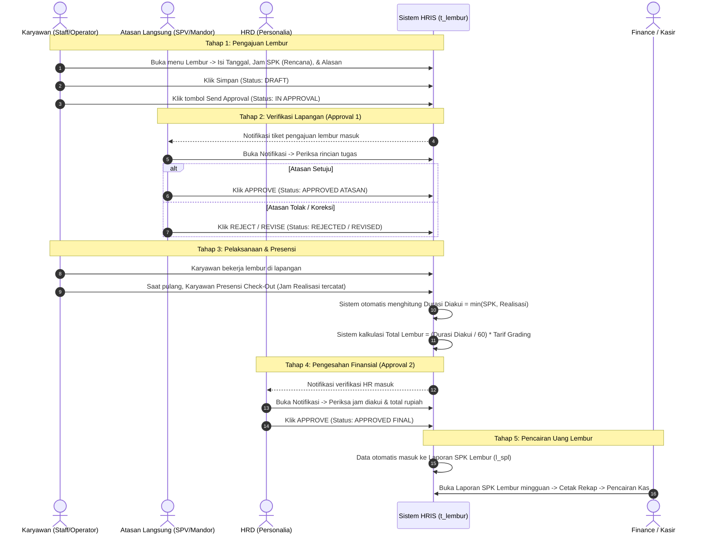

# 📘 SOP & PANDUAN LENGKAP ALUR LEMBUR (SPK LEMBUR) HRIS BBS
**Dokumen Referensi Resmi Tim Teknis & Operasional HRIS BBS**  
**Tanggal Penyusunan:** Kamis, 29 Oktober 2026  
**Dasar Kebijakan:** Notulensi Rapat (MoM) 7 Oktober 2026 & Konfirmasi Langsung Manajemen BBS (Pak Andik) pada 29 Oktober 2026  
**Penanggung Jawab Sistem:** Rey (Lead Dev), Mas Duta (On-Site/QA Support), Tim Pengembang HRIS

---

## 🧭 1. Latar Belakang & Filosofi "SPK Lembur" di BBS

Sering timbul kerancuan di antara tim: *"Apakah di BBS ada 2 jenis lembur: Lembur Biasa vs SPK Lembur?"*

### JAWABAN TEGAS:
> **DI SISTEM HRIS BBS HANYA ADA 1 MODUL LEMBUR, YAITU: TRANSAKSI LEMBUR (`t_lembur`).**  
> Tidak ada pemisahan menu antara "lembur biasa" dan "SPK lembur". Keduanya adalah entitas yang sama.

### Mengapa Disebut "SPK Lembur" (Surat Perintah Kerja Lembur)?
1. **Regulasi Ketenagakerjaan (Kepmenakertrans No. 102/2004):**  
   Perusahaan secara hukum **wajib** menerbitkan Surat Perintah Kerja Lembur tertulis yang memuat daftar nama karyawan, waktu mulai, waktu selesai, dan persetujuan pekerja bersangkutan.
2. **Karakteristik Operasional Pabrik Beras BBS:**  
   BBS adalah industri manufaktur & pengolahan beras dengan perputaran shift kerja yang ketat. Manajemen BBS memberlakukan aturan: **Karyawan TIDAK BOLEH melakukan lembur liar.**  
   Artinya, karyawan yang pulang malam tanpa izin/perintah tidak dapat mengklaim uang lembur sepihak. Setiap menit lembur yang dibayar perusahaan harus memiliki **plafon/kuota rencana** yang disetujui atasan.
3. **Mengapa Karyawan yang Menginput ke Sistem?**  
   Pak Andik (Manajemen BBS) menegaskan:  
   > *"Dari karyawan mestinya mbak. 2 kali approval dari atasan sama HR."*  
   
   Jika Atasan atau HR yang harus menginputkan pengajuan lembur puluhan/ratusan staf satu per satu, beban administrasi HR akan sangat berat. Oleh karena itu, **karyawan yang menginput formulir di sistem sebagai inisiator**, kemudian **disahkan oleh Atasan (sebagai pihak yang memberi perintah/izin)**, dan **diverifikasi oleh HRD**.

---

## 👥 2. Matriks Peran & Tanggung Jawab

| Peran / Aktor | Tanggung Jawab di Sistem | Titik Interaksi |
|---|---|---|
| **Karyawan** *(Pemohon)* | Mengajukan rencana lembur: mengisi tanggal, jam mulai, jam selesai rencana, dan alasan pekerjaan. | Menu `Transaksi > Lembur` (via Mobile / Web) |
| **Atasan Langsung** *(SPV / Mandor / Kabag)* | **Approval Tingkat 1:** Memvalidasi urgensi operasional di lapangan. Memeriksa apakah pekerjaan tersebut memang memerlukan lembur dan apakah tugas terselesaikan dengan benar. | Menu `Notifikasi` $\rightarrow$ Klik **Approve / Reject / Revise** |
| **HRD** *(Personalia)* | **Approval Tingkat 2:** Memvalidasi kepatuhan aturan, batas maksimum jam lembur, dan absensi hari itu. Begitu HRD menyetujui, lembur sah untuk dibayarkan. | Menu `Notifikasi` $\rightarrow$ Klik **Approve / Reject** |
| **Finance / Kasir** | Mengunduh rekapitulasi total jam dan nominal uang lembur mingguan untuk dasar pencairan voucher kas. | Menu `Laporan > Laporan SPK Lembur (l_spl)` |

---

## 🔄 3. Alur Proses Kerja (End-to-End Workflow)

---

## 🧮 4. Logika Perhitungan Durasi & Nilai Uang Lembur

Sesuai kesepakatan **MoM BBS 7 Oktober 2026 Poin 3.K**, rumus penguncian durasi lembur adalah:

$$\mathbf{Durasi\ Diakui} = \min(\mathbf{Durasi\ Rencana\ SPK},\ \mathbf{Durasi\ Realisasi\ Faktual})$$

$$\mathbf{Total\ Uang\ Lembur} = \frac{\mathbf{Durasi\ Diakui\ (Menit)}}{60} \times \mathbf{Tarif\ Lembur\ Grading\ (m\_lembur)}$$

### Tabel Simulasi Kasus Nyata:

| Skenario Kasus | Rencana Jam SPK | Jam Realisasi Absen | Durasi SPK | Durasi Realisasi | Durasi Diakui Sistem | Alasan Bisnis |
|---|:---:|:---:|:---:|:---:|:---:|---|
| **Kasus 1: Pulang Lebih Cepat** | 17:00 – 20:00 | 17:00 – 19:00 | 180 mnt (3 jam) | 120 mnt (2 jam) | **120 menit (2 jam)** | Perusahaan hanya membayar jam kerja riil karyawan. |
| **Kasus 2: Pulang Molor (Overtime)** | 17:00 – 20:00 | 17:00 – 21:30 | 180 mnt (3 jam) | 270 mnt (4.5 jam) | **180 menit (3 jam)** | Perusahaan tidak kecolongan bayar lebih karena atasan hanya menyetujui anggaran plafon 3 jam. |
| **Kasus 3: Sesuai Rencana** | 17:00 – 20:00 | 17:00 – 20:00 | 180 mnt (3 jam) | 180 mnt (3 jam) | **180 menit (3 jam)** | Jam kerja riil presisi sama dengan izin SPK. |
| **Kasus 4: Realisasi Belum Ada** | 17:00 – 20:00 | *(Belum absen)* | 180 mnt (3 jam) | 0 menit | **180 menit (Estimasi)** | Dipakai sebagai estimasi cadangan saat pengajuan awal. |

> [!IMPORTANT]
> **User tidak perlu menghitung menit secara manual.**  
> Di form `t_lembur`, user hanya memilih jam mulai dan jam selesai (tersedia picker waktu). Kolom *Durasi SPK*, *Durasi Realisasi*, *Durasi Diakui*, dan *Estimasi Total Lembur* berstatus **Read-Only** dan otomatis dihitung oleh sistem.

---

## 📌 5. Skenario Operasional di Lapangan

### Skenario A: Pengajuan Sebelum Lembur (Normal / Ideal)
1. Pukul 16:30, karyawan mengetahui ada tugas mendesak dari atasan atau kiriman beras masuk.
2. Karyawan membuka menu **Lembur**, memilih tanggal hari ini, mengisi rencana jam 17:00 – 20:00, lalu klik **Simpan & Send Approval**.
3. Atasan menerima notifikasi di ponsel/laptop dan menekan **Approve**.
4. Pukul 20:00, karyawan selesai bekerja dan melakukan presensi check-out.
5. Tiket diperiksa dan disetujui HRD $\rightarrow$ status menjadi `APPROVED`.

### Skenario B: Pengajuan Susulan (H+1 / Keadaan Darurat Lapangan)
1. Di pabrik terjadi kendala mesin giling beras jam 17:00, karyawan langsung bekerja lembur darurat hingga larut malam tanpa sempat membuka aplikasi.
2. Keesokan paginya (H+1), karyawan membuka menu **Lembur**, memilih tanggal kemarin, mengisi jam rencana dan jam realisasi kemarin, lalu menekan **Send Approval**.
3. Atasan menerima tiket:
   - Jika atasan mengonfirmasi adanya darurat kemarin $\rightarrow$ Atasan klik **Approve**.
   - Jika karyawan mengaku-ngaku lembur padahal tidak ada pekerjaan $\rightarrow$ Atasan klik **Reject**.
4. Jika disetujui atasan, tiket lanjut ke HRD untuk verifikasi $\rightarrow$ status `APPROVED`.

---

## 💰 6. Kebijakan Pencairan & Laporan SPK Lembur

Berdasarkan kesepakatan MoM BBS 7 Oktober 2026:
- **Lembur TIDAK DIGABUNGKAN ke dalam Slip Gaji Bulanan reguler.**
- Lembur dicairkan secara tersendiri dengan siklus **Mingguan** (atau per periode SPK) melalui kas kecil / cash voucher Finance.
- Dokumen resmi yang digunakan sebagai dasar pembayaran adalah:  
  📄 **Menu Laporan $\rightarrow$ Laporan SPK Lembur (`l_spl`)**
- Karakteristik Laporan SPK Lembur:
  - Hanya menampilkan data yang berstatus **`APPROVED`**. Data yang masih `DRAFT` atau `IN APPROVAL` otomatis difilter keluar.
  - Dapat difilter berdasarkan rentang tanggal mingguan, cabang (Direktorat), divisi, departemen, tipe lembur, maupun nama karyawan.
  - Memuat rincian: *Tanggal, Jam SPK, Jam Realisasi, Durasi Diakui, Tarif per Grading, dan Total Nominal Uang Lembur* lengkap dengan grand total di baris paling bawah.

---

## 🛠️ 7. Arsitektur Teknis & File Codebase Terkait

| Komponen | File Path | Fungsi Utama |
|---|---|---|
| **View Template** | [`Blades/t_lembur.blade.php`](file:///c:/Users/Rey%20Cannavaro/hris-bbs-dev/Blades/t_lembur.blade.php) | Form input lembur, indikator readonly saat in-approval, modal log approval, dan tombol aksi. |
| **Vue SFC Controller** | [`Javascript/t_lembur.js`](file:///c:/Users/Rey%20Cannavaro/hris-bbs-dev/Javascript/t_lembur.js) | Logika reaktif durasi jam, format tanggal DD/MM/YYYY, action button send approval, dan status badge renderer. |
| **Custom Model Backend** | [`Models/t_lembur/Custom.php`](file:///c:/Users/Rey%20Cannavaro/hris-bbs-dev/Models/t_lembur/Custom.php) | Endpoint perhitungan tarif `m_lembur`, tiket approval `createAppTicket`, validasi hak akses atasan/superadmin, dan mutasi status. |
| **Laporan Cetak Lembur** | [`Blades/web_report_lembur.blade.php`](file:///c:/Users/Rey%20Cannavaro/hris-bbs-dev/Blades/web_report_lembur.blade.php) | Template cetak slip rekapitulasi SPK lembur siap cetak A4/PDF dengan filter aktif dan grand total. |
| **Engine Approval** | [`Models/generate_approval/custom.php`](file:///c:/Users/Rey%20Cannavaro/hris-bbs-dev/Models/generate_approval/custom.php) | Core engine approval bertingkat, penanganan aksi approve/reject/revise, dan log audit trail. |

---

## ❓ FAQ (Frequently Asked Questions)

**Q: Apakah karyawan bisa asal klaim jam lembur sesuka hati?**  
*A: Tidak bisa.* Pertama, pengajuan wajib disetujui oleh Atasan Langsung di Approval 1. Kedua, jika jam checkout absen lebih sedikit dari jam klaim, sistem otomatis memotongnya mengikuti jam riil ($\min(\text{SPK}, \text{Realisasi})$).

**Q: Bagaimana jika atasan sedang cuti/dinas luar kota?**  
*A: Sistem menyediakan bypass wewenang untuk **Superadmin** / HR Manager yang memiliki hak akses approval darurat.*

**Q: Apakah data lembur yang ditolak (REJECTED) bisa diajukan ulang?**  
*A: Data yang direvisi (REVISED) dapat diedit kembali jam/alasannya oleh karyawan lalu dikirim ulang (Send Approval). Data yang ditolak permanen (REJECTED) akan terkunci sebagai arsip audit.*

---
*Dokumen ini merupakan panduan resmi pengembangan modul Lembur HRIS BBS Dev.*

